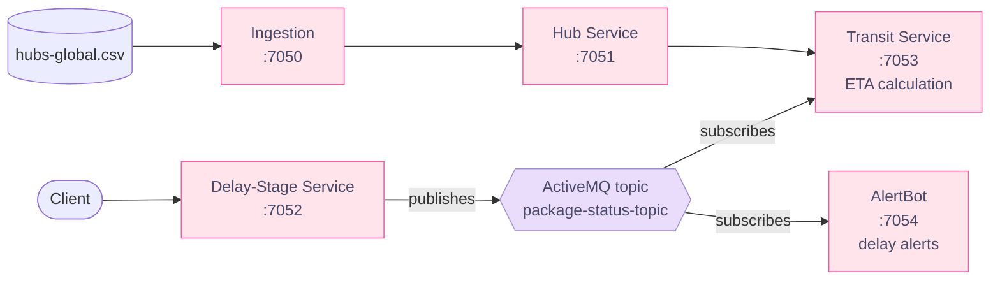

  

  

  
  
  

  
  

---

## 🌸 About Me
I'm a software engineering student at **WeThinkCode_**, where learning means building, breaking and fixing real projects. I'm most at home where systems meet data: connecting services so information flows, then cleaning and analysing it so it can be trusted. I also have a growing interest in **AI, cybersecurity and networking**, and I document the journey right here.

## 📈 My Work in Numbers

| 🧪 **33** | 📊 **6** | 🔗 **5** | 🔁 **4** |
|:---:|:---:|:---:|:---:|
| automated tests on my data cleaning rules | charts generated by one analysis pipeline | independent services in my microservices project | stages: cleanup → REST → messaging → alerts |

---

## 🚀 Featured Projects

### 📊 [logistics-analytics](https://github.com/seapei20/logistics-analytics): Data Cleaning & Shipment Analytics
Takes messy legacy exports, cleans them with documented and tested rules, and analyses delivery performance across South African provinces.

**Questions it answers:** Which provinces and hubs deliver worst on time? Does the delay stage predict slow deliveries? What does express really cost per kilo? Can the hub master data be trusted?

**Decisions I'm proud of:**
- 🧾 **Nothing disappears silently.** Every rejected row is saved with its line number and reason, and a test checks that clean rows plus rejected rows equal the raw rows.
- 🚫 **No guessing.** Missing values stay blank instead of being imputed, so no invented cost-per-kilo figures.
- 🔍 **Honest about the data.** The shipments table is synthetic, and the README says so.

`Python` `Pandas` `NumPy` `Matplotlib` `Pytest`

---

### 🚚 [sin-001-logisticsconnect](https://github.com/seapei20/sin-001-logisticsconnect): Parcel Delay Tracking with Microservices
Five independent Java services that clean hub data, serve it over REST, track transit delay stages, calculate arrival windows and raise delay alerts. Built in four stages, from CSV cleanup to REST calls to ActiveMQ messaging to alerting.

**What I learned:** replacing a direct REST call with a message topic means ETAs still work when the delay-stage service is down. The trade-off is that a plain topic doesn't replay, so a change published while a subscriber is offline can be missed. A durable subscriber would close that gap.

`Java` `Maven` `REST` `ActiveMQ` `Docker`

---

## 🛠️ Tech Stack

## ✨ How I Work
- 🧪 I test the rules I claim to follow
- 📝 I write down *why* I made a decision, not just what I did
- 🔎 I'd rather say "this data is synthetic" than overclaim
- 🌱 I learn by building, then documenting what broke

## 💖 Right Now
- 🎓 Studying software engineering at WeThinkCode_
- 🔭 Building projects in data analytics and system integration
- 🌱 Exploring AI, cybersecurity and networking
- 💼 Looking for internships and people to build with

## 📊 GitHub Stats

  
  

---

  💬 <b>Let's connect!</b> I'm always up for a conversation about data, systems and building useful things.

  

